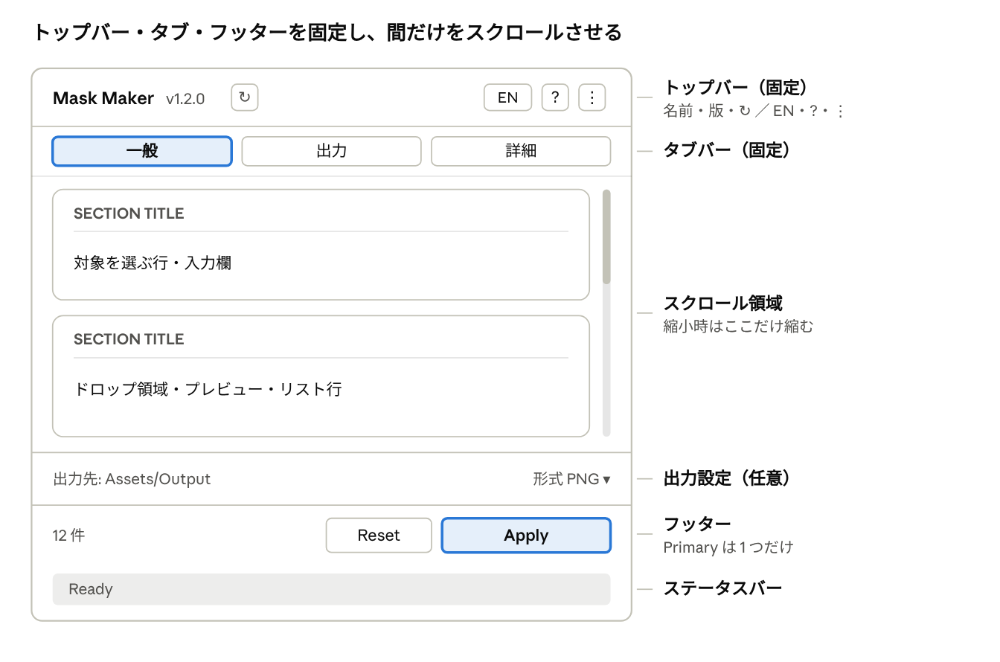

# dennokoworks UI コンポーネント案

2026-11-05 · dennoko
（オンライン版: https://claude.ai/artifact/Ne9ejUZVDwknWKHYkxtkC3 ）

## 概要と方針

dennokoworks の各ツールで繰り返し作られているウィンドウ部品を、粒度の大きいコンポーネントとしてスキル（dennokoworks-design）に定義し、ツール間の見た目と操作を統一する。最初に定義するのはトップバーで、その後にタブ・フッター・カード内部品を続ける。

| 項目 | 方針 |
| --- | --- |
| 配布形式 | VPM リポジトリ（共通パッケージ）は作らない。スキルのテンプレートを各ツールへコピーし、namespace を書き換えて使う（現行の DennokoTheme.uss / DennokoUIFont.cs と同じ） |
| 言語設定 | ツールごとに個別に保存する（全ツール共通の言語設定は持たない）。保存キーの命名だけを統一する |
| 実装の分担 | 見た目は DennokoTheme.uss のクラス、構造は UXML の雛形、繰り返す処理は小さな C# ヘルパー |
| 検証の流れ | UI Design Test に実装 → Unity 実機で確認 → スキルへ反映、の順で 1 コンポーネントずつ進める |



上からトップバー、タブバー、スクロール領域、出力設定、フッター、ステータスバーの順に並べ、スクロール領域以外はウィンドウを縮めても潰さない。

## 現状調査

`Assets/dennokoworks/` の約40ツールのうち、UI Toolkit + DennokoTheme を使うのは約17本、IMGUI のままが約20本。ウィンドウの骨組み（ヘッダー → タブ → スクロール → フッター → ステータス）は共通だが、載る部品はツールごとの接頭辞（`hct-` / `br-` / `mm-` / `nmg-` / `unitex-` / `dmat-`）で作り直されている。

| 部品 | 実装のばらつき | 主なツール |
| --- | --- | --- |
| ヘッダー | タイトル + バージョン + ↻ は共通。↻ なし、サブタイトル、設定ボタンの有無がツールごとに異なる | HairChimera（↻ なし）、DennokoMAT（サブタイトル）、MaskMakerV4（設定 ⚙） |
| 言語切替 | 6通り。`dennoko-lang-button` を 3 ツールが別々に定義、`dmat-lang-button`、インライン style、クラスなし、JA/EN の 2 ボタン型 | DenEmo / FolderCleaner / MeshSplitter / DennokoMAT / FastCurvatureBaker / UniTex / MaskMakerV4 / NormalMapGenerator |
| タブ | 4通り。均等割り、幅 130px 固定、番号付きの手順タブなど | HairChimera / DenEmo / BatchRenamer / MaskMakerV4 |
| フッター | 縦積み・横並び・カード囲みが混在。件数表示や出力設定を入れるツールもある | BatchRenamer / UniTex / NormalMapGenerator / DennokoMAT |
| 対象を選ぶ行 | ObjectField の横のボタンが約7通り（✕ / 選択から / 再読込 / New / 参照 / 編集▶ / Get From Selection） | HairChimera / DenEmo / BatchRenamer / FolderTreeExporter / MatcapMaker |
| 補足文・空の状態 | `hct-note` / `mm-hint` / `br-hint` / `nmg-hint` / `unitex-caption` / `dennoko-hint` / `br-empty` など | ほぼ全ツール |
| 小さなアイコンボタン | 5通り（`dennoko-mini-button` / `mm-icon-button` / `dmat-small-button` / `dennoko-icon-mini` / `dennoko-row-icon-button`） | DenEmo / MaskMakerV4 / DennokoMAT |
| ドロップ領域・プレビュー | 各ツールが独自実装 | FastCurvatureBaker / FolderTreeExporter（ドロップ）、DennokoMAT / HairChimera / NormalMapGenerator / UniTex（プレビュー） |
| ステータスの警告表示 | `dennoko-status--warning` を DenEmo だけが独自定義 | DenEmo |

C# 側では `DennokoVersionChecker.cs` が 16 ツールにコピーされ、ローカライズは 10 ツールが別々に実装している。設定メニューは MaskMakerV4 が `GenericDropdownMenu` で先行実装しており、アイコンが無いときは文字（⚙）に戻す仕組みもある。

## トップバー（テンプレート）

全ツールのウィンドウ最上部を「左：ツール名 + バージョンチェック、右：言語切替（1 ボタン） + マニュアル + 設定」の 1 行に揃える。右側のアイコンは Unity のアセットインポーター Inspector のヘッダー右上（? と ⋮）と同じ見た目・並びにする。

### 構成要素

| # | 要素 | 見た目 | 動作 | 必須 |
| --- | --- | --- | --- | --- |
| 1 | ツール名 | `.dennoko-title`（14px 太字、Primary） | — | 必須 |
| 2 | バージョン表示 | `.dennoko-version-label`（10px、Tertiary）。更新あり = `--update`（緑・太字）、取得失敗 = `--error`（警告色） | 更新ありのときだけクリック可能にし、version.json の `url`（配布ページ）を開く | 必須 |
| 3 | 再確認 ↻ | アイコンボタン（20px 角） | 更新チェックをやり直し、「確認中…」を表示 | 必須 |
| 4 | 言語切替 | 文字ボタン 1 つ（幅 32px、高さ 20px、11px）。**切替先の言語を表示**（日本語表示中は「EN」） | クリックで ja ⇔ en を切り替え、ツールごとに保存。ツールチップは「Switch to English」「日本語に切り替え」 | 必須 |
| 5 | マニュアル ? | アイコンボタン。Unity 組み込みのヘルプアイコン（`_Help`、無ければ文字「?」） | 現在の言語のマニュアル URL を開く。URL 未設定のツールでは非表示 | 任意 |
| 6 | 設定 ⋮ | アイコンボタン。Unity 組み込みのメニューアイコン（`_Menu` 系、無ければ文字「⋮」） | ドロップダウンメニュー（下表）を開く | 必須 |

設定メニューの中身は、共通項目を下に固定し、ツール固有の項目を上に足せる形にする。

| 位置 | 項目 | 内容 |
| --- | --- | --- |
| 上段 | ツール固有 | 各ツールが `AddMenuItem()` で追加（例：Preferences を開く、プリセット管理） |
| 下段 | 設定を初期値に戻す | ツールが登録したリセット処理を、確認ダイアログのあとに実行 |
| 下段 | 更新を確認 | ↻ と同じ |
| 下段 | 配布ページを開く | version.json の `url` |
| 下段 | バージョン情報 | ツール名・現在のバージョン・最新バージョンを表示（選択不可の行） |

### UXML の雛形

```xml
<ui:VisualElement name="appbar" class="dennoko-appbar">
    <ui:VisualElement class="dennoko-appbar__title">
        <ui:Label name="appbar-title" text="TOOL NAME" class="dennoko-title" />
        <ui:Label name="version-label" class="dennoko-version-label" />
        <ui:Button name="version-reload-button" class="dennoko-icon-button" />
    </ui:VisualElement>
    <ui:VisualElement class="dennoko-appbar__actions">
        <ui:Button name="appbar-lang" class="dennoko-appbar-lang" />
        <ui:Button name="appbar-manual" class="dennoko-icon-button" />
        <ui:Button name="appbar-settings" class="dennoko-icon-button" />
    </ui:VisualElement>
</ui:VisualElement>
```

- `.dennoko-appbar` は今の `.dennoko-header` + 直後の `.dennoko-separator` を置き換える（下罫線を自分で持ち、`flex-shrink: 0`）。今のクラスは当面そのまま動くように残す。
- アイコンの画像、ツールチップ、文言は C# 側（`DennokoAppBar`）が入れる。UXML には書かない。
- 狭いウィンドウではツール名を省略表示（…）にし、右側の 3 つは縮めない。

### C# API（案）

```csharp
var appBar = DennokoAppBar.Bind(root, new DennokoAppBar.Options
{
    ToolName      = "Mask Maker",
    Version       = MaskMakerVersion.Instance,     // 既存の YourToolVersion をそのまま渡す
    Language      = MaskMakerLanguage.Instance,    // ツール個別の言語設定（下記）
    ManualUrlJa   = "https://.../manual_ja",
    ManualUrlEn   = "https://.../manual_en",       // 未設定なら ja を使う。両方空なら ? を隠す
    OnResetSettings = ResetAllSettings,             // null なら「初期値に戻す」を出さない
});
appBar.AddMenuItem(L("Preferences を開く"), () => SettingsService.OpenUserPreferences("Preferences/Mask Maker"));
appBar.LanguageChanged += RefreshTexts;             // 言語切替後に全文言を入れ直す
```

言語設定はツール個別に保存するが、保存方法だけ統一する。今は string / bool / int とキー名がツールごとに異なる。

- 保存先：`EditorPrefs` の文字列、キーは `dennokoworks.<ToolId>.language`、値は `ja` / `en`（既定は `ja`）
- 既存ツールを移行するときは、初回だけ旧キーを読んで新キーへ書き写す（`LegacyKey` を渡せるようにする）
- 文言の辞書（Loc / JSON）は各ツールのものをそのまま使う。トップバー自身の文言（ツールチップ・メニュー）だけテンプレートに内蔵する

## タブバー / 手順タブ

タブは `.dennoko-tabbar` 1 種類にまとめ、「切り替えるだけのタブ」と「順に進む手順タブ」を修飾クラスで切り替える。置き場所はトップバーの直下（スクロール領域の外）で固定する。

| 種類 | クラス | 見た目 | 使う場面 | 置き換え対象 |
| --- | --- | --- | --- | --- |
| 通常タブ | `.dennoko-tabbar` + `.dennoko-tab` | 均等割り、選択中は青枠 + 青ティント（`.dennoko-button-active` と同じ） | モード切替（Pose / Animation / FX、機能別のパネル） | DenEmo / BatchRenamer / MaskMakerV4 |
| 手順タブ | `.dennoko-tabbar--steps` | 番号付き。完了した手順は番号を ✓ にし、未到達の手順は Tertiary 文字 | 前の手順の結果を使う作業（切り分け → パーツ → … → 出力） | HairChimera |

- タブが多くて幅が足りないときは文字を省略表示にし、ツールチップで全文を出す。折り返しはしない。
- 最後に開いていたタブをツールごとに記憶する（`EditorPrefs`、キーは `dennokoworks.<ToolId>.tab`）。
- 手順タブでも前後への移動は自由にし、未完了の手順を飛ばしたときはそのパネル側で空の状態（後述）を出す。

```csharp
var tabs = DennokoTabs.Bind(root,
    tabs:   new[] { "tab-split", "tab-parts", "tab-export" },
    panels: new[] { "panel-split", "panel-parts", "panel-export" },
    prefsKey: "dennokoworks.HairChimera.tab");
tabs.SetStepDone(0, true);    // 手順タブのみ。番号が ✓ になる
tabs.Changed += index => { /* パネルごとの更新 */ };
```

## フッター・出力設定・ステータスバー

ウィンドウ下部は「出力設定（任意）→ アクション行 → ステータスバー」の 3 段で固定し、どれもスクロール領域の外に置く。フッターはカードで囲まず、上罫線 1 本で仕切る（現行の `.dennoko-footer` を拡張）。

| 段 | クラス | 中身 | 置き換え対象 |
| --- | --- | --- | --- |
| 出力設定 | `.dennoko-output` | 出力先パス（読み取り専用、長ければ先頭を省略）+「選択…」、上書きトグル、形式・解像度のドロップダウンを 1〜2 行で | `unitex-output-row` / NormalMapGenerator の OUTPUT / `dmat-footer-row` |
| アクション行 | `.dennoko-footer` | 左：情報欄 `.dennoko-footer__info`（件数など、Tertiary）。右：Secondary（固定幅）→ Primary（伸びる）。Primary は 1 つだけ | BatchRenamer（件数 + 元に戻す + 一括適用）、各ツールの縦積みフッター |
| ステータスバー | `.dennoko-status` | 既存の success / error に加え、`--warning`（アンバー背景）と `--busy`（処理中。文字の下に細い進捗バー）を追加 | DenEmo 独自の `--warning`、各ツールの処理中表示 |

- 手順タブのツール（HairChimera）は、タブごとに主アクションが変わる。フッターは 1 つのまま、タブ切替でボタンの文言と処理を入れ替える。各パネルの中にフッターを置かない。
- 削除など取り消せない操作は Primary にしない。Secondary に置き、押したときに確認ダイアログを出す（FolderCleaner の「削除を実行」など）。

```csharp
SetStatus("処理中… (3/10)", StatusType.Busy, progress: 0.3f);  // 進捗バー付き。自動で Ready には戻らない
SetStatus("一部のテクスチャをスキップしました", StatusType.Warning);
```

## カード内コンポーネント

カードの中で繰り返し使われている 8 つの部品を、テーマのクラスとして定義する。各ツールの独自クラス（`hct-note` など）は、移行時にこれらへ置き換える。

| コンポーネント | クラス | 中身とルール | 置き換え対象 |
| --- | --- | --- | --- |
| アイコンボタン | `.dennoko-icon-button` | 20px 角。通常は枠なし、ホバーで枠と背景。用途を ↻ / ✕ / ? / ⋮ / ▶ に限る。アイコン画像が無いときは文字に戻す | `dennoko-mini-button` / `mm-icon-button` / `dmat-small-button` / `dennoko-icon-mini` / `dennoko-row-icon-button`、`.dennoko-version-reload-button` |
| セクション見出し | `.dennoko-card-header`（拡張） | 見出し文字 + ヘルプ ?（ツールチップ）+ 右端の操作欄（Reset など）。トグル付きセクションも同じ行構成にする | FolderCleaner の `section-help-icon`、`.dennoko-toggle-header` |
| 対象を選ぶ行 | `.dennoko-target-row` | ObjectField（伸びる）+ 固定幅ボタン。ボタンは「選択から」「New」「✕」の 3 種類に絞り、文言と幅を統一する | HairChimera / DenEmo / BatchRenamer / FolderTreeExporter / MatcapMaker / DennokoMAT |
| ドロップ領域 | `.dennoko-drop-zone` | 点線枠 + 案内文。ドラッグ中（青枠）・受け付けない対象（赤枠 + 理由）・受け付け済み（件数表示）の状態を持つ | FastCurvatureBaker / FolderTreeExporter |
| 検索・フィルタ行 | `.dennoko-searchbar` + `.dennoko-chip` | 検索欄（入力中のみ ✕）+ 絞り込みチップ。チップは ON で青（selection 色） | DenEmo / BatchRenamer |
| プレビュー領域 | `.dennoko-preview` | Surface0 の枠、縦横比の固定（正方形 / 自由）、「まだ何もない」ときの案内文、右上に重ねる小さなツールバー | DennokoMAT / HairChimera / NormalMapGenerator / UniTex / FolderTreeExporter |
| リスト行 | `.dennoko-list-row` | アイコン・名前・補足・右端の操作。ListView の行テンプレート（行専用の UXML）として配布する | DenEmo の ShapeKeyRow、DennokoMAT の MaskItem |
| 補足文・空の状態 | `.dennoko-hint` / `.dennoko-empty-state` | 補足文は 11px ・Tertiary・折り返し。空の状態は中央寄せのメッセージ + 次にやる操作のボタン 1 つ | `hct-note` / `mm-hint` / `br-hint` / `nmg-hint` / `unitex-caption` / `br-empty` / 各リストの empty ラベル |

対象を選ぶ行の雛形：

```xml
<ui:VisualElement class="dennoko-target-row">
    <uie:ObjectField name="avatar-field" label="アバター" class="dennoko-col-grow"
        type="UnityEngine.GameObject, UnityEngine.CoreModule" allow-scene-objects="true" />
    <ui:Button name="avatar-from-selection" text="選択から" class="dennoko-target-row__action" />
</ui:VisualElement>
```

## C# 共通ヘルパー（DennokoUIKit）

繰り返し書かれている接続処理を、スキルの `assets/UIKit/` に小さなクラスとして置き、各ツールへコピーして使う。現行の `DennokoUIFont.cs` と同じく namespace をツールに合わせ、`internal` にして他ツールのコピーと衝突させない。

| クラス | 責務 | 主な API |
| --- | --- | --- |
| `DennokoAppBar` | トップバーの接続。バージョン表示と ↻、言語ボタン、マニュアル、設定メニュー | `Bind(root, Options)` / `AddMenuItem(label, action)` / `LanguageChanged` |
| `DennokoLanguage` | ツール個別の言語設定（ja / en）の保存と変更通知。旧キーからの移行 | `new DennokoLanguage(toolId, legacyKey)` / `Current` / `Toggle()` / `Changed` |
| `DennokoIcons` | Unity 組み込みアイコンの読み込み。無ければ文字に戻す（MaskMakerV4 の `Icons.Apply` を一般化） | `Apply(button, iconName, fallbackText, tooltip)` |
| `DennokoTabs` | タブの切替、記憶、手順の完了表示 | `Bind(root, tabs, panels, prefsKey)` / `Select(i)` / `SetStepDone(i, done)` / `Changed` |
| `DennokoStatus` | ステータスバーの状態切替と自動復帰。今は各ウィンドウの `SetStatus()` | `Set(message, type, progress)` |
| `DennokoSections` | トグル付きセクションの折りたたみ。今の `BindToggleSection()` | `BindToggle(root, toggle, content, reset, onReset)` |
| `DennokoDropZone` | ドロップ領域のドラッグ処理と状態クラスの付け外し | `Bind(element, accept: obj => bool, onDrop)` |

- バージョンチェック本体（`DennokoVersionChecker.cs` / `YourToolVersion.cs`）は今のテンプレートをそのまま使い、`DennokoAppBar` は表示だけを担当する。
- 1 ツールに必要なのは使うクラスだけ。トップバーだけなら `DennokoAppBar` / `DennokoLanguage` / `DennokoIcons` の 3 ファイル。
- UIKit にはバージョン番号を付け（各ファイル先頭のコメント）、ツール側のコピーが古いかどうかを判別できるようにする。

## 導入ステップと検証計画

トップバーから 1 つずつ、これまでと同じ「UI Design Test で実装 → Unity で確認 → スキルへ反映」の流れで進める。

1. **トップバー**：UI Design Test のヘッダーを `.dennoko-appbar` に置き換え、`DennokoAppBar` / `DennokoLanguage` / `DennokoIcons` を実装。Light / Dark 両テーマでアイコンが表示されるかを確認してからスキルへ反映
2. **タブバー / 手順タブ**：UI Design Test の「TOOLBAR & TABS」を差し替え、手順タブのサンプルを追加
3. **フッター・出力設定・ステータス**：情報欄、`.dennoko-output`、`--warning` / `--busy` を追加
4. **カード内コンポーネント**：アイコンボタン → 対象を選ぶ行 → 補足文・空の状態 → セクション見出し → 検索 → ドロップ領域 → プレビュー → リスト行の順（使うツールが多いものから）
5. **実ツールへの先行適用**：実装差が大きい 3 ツールで効果を確かめる
    1. MaskMakerV4：設定メニューとアイコンの仕組みが既にあり、トップバーの移行が最も小さい
    2. DenEmo：タブ・検索・リスト行・独自の `dennoko-*` クラスが最も多い
    3. HairChimera：手順タブとタブごとのフッターを検証できる
6. **残りの UI Toolkit ツールへ展開**。IMGUI の約20ツールは、UI Toolkit へ移行するときにまとめて適用する

各ステップで確認すること：

- [ ] Light / Dark 両テーマでアイコン画像が消えないか（消える場合は文字へ戻るか）
- [ ] ウィンドウを 360px まで狭めても、トップバー右側とフッターのボタンが潰れないか
- [ ] 言語切替の直後に、ツールチップとメニューを含む全文言が入れ替わるか
- [ ] 旧キーの言語設定が新キーへ引き継がれるか

## 未決事項

- [ ] 「マニュアルを開く（Asset Importer 形式）」の解釈：本案では「Unity のインポート設定 Inspector 右上と同じ ? アイコンで、マニュアル URL をブラウザで開く」とした。パッケージ同梱の文書を Unity 内で開く形式など別の意味なら修正する
- [ ] 設定アイコンの形：⋮（Inspector ヘッダーと同じ）と ⚙（MaskMakerV4 と同じ）のどちらにするか
- [ ] マニュアル URL の置き場所：各ツールの C# 定数にするか、version.json に `manual` 項目を足してリモートから差し替えられるようにするか
- [ ] 言語の既定値：常に `ja` にするか、OS の言語設定が日本語以外なら `en` にするか
- [ ] 設定メニューの共通項目：「設定を初期値に戻す」「更新を確認」「配布ページ」「バージョン情報」以外に入れたいものがあるか（不具合報告フォームなど）
